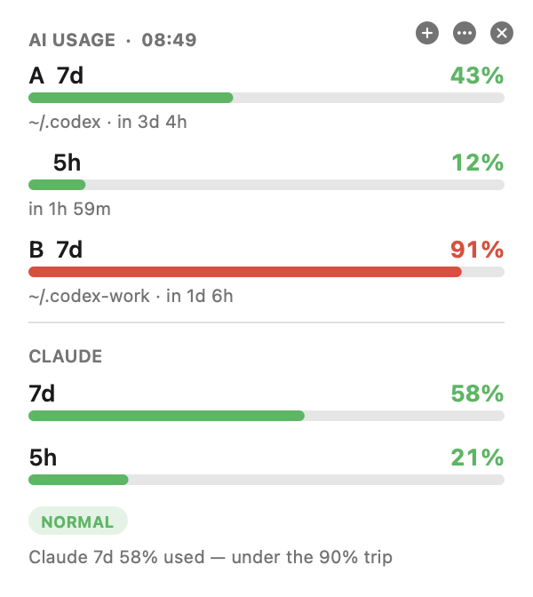

# AI Usage Tracker

A small macOS desktop widget that shows how much of your **OpenAI Codex** and **Claude
Code** subscription usage is left — per Codex account, plus Claude's own 7-day and 5-hour
windows — so you know which one to use before you start a big task.



- **A card on your desktop**, behind your other windows like an iPhone widget (one per display).
- **A menu bar chip** such as `A43 B91 CL58`, coloured green / amber / red.
- **Several Codex logins** side by side (work, personal, …), each in its own `CODEX_HOME`.
- **A terminal report**: `~/.ai-usage-tracker/ai-usage`.
- Refreshes every 5 minutes and when your Mac wakes up.

Your logins stay where Codex and Claude Code put them, and tokens are only ever sent to the
provider that issued them. See [Security and privacy](#security-and-privacy).

## Requirements

- macOS 13 (Ventura) or newer.
- Xcode Command Line Tools, which provide `swiftc` and `python3`. Install them with
  `xcode-select --install`. You don't need the full Xcode app.
- At least one of:
  - [Codex CLI](https://github.com/openai/codex), signed in with a ChatGPT plan (`codex login`).
  - [Claude Code](https://docs.anthropic.com/en/docs/claude-code), signed in with a Claude plan.

## Install with Claude Code or Codex

Paste this into Claude Code or Codex on the Mac where you want the widget:

```text
Install AI Usage Tracker from https://github.com/Av3rageJoe/AI-Usage-Tracker on this Mac.

1. Check that macOS is 13 or newer and that `xcode-select -p` succeeds. If it fails, run
   `xcode-select --install`, then wait for me to finish the installer before going on.
2. Clone the repo into ~/src/AI-Usage-Tracker (create ~/src if needed). Do not clone it
   inside ~/Documents or ~/Desktop, because those folders may sync to iCloud.
3. Read install.sh and uninstall.sh before running anything, and tell me if anything in
   them looks unsafe.
4. Run `sh tests/run.sh`. It works offline and touches no real account. Stop and show me
   the output if any test fails.
5. Run `./install.sh`.
6. Verify with:
   "$HOME/Applications/AI Usage Tracker.app/Contents/MacOS/AIUsageTracker" --dump
   It should print one row per usage window, a "mode:" line and a "menu bar:" line.
   An account showing "—" with "no-auth" just means that Codex login doesn't exist yet.
7. If I have more than one Codex login (folders like ~/.codex-work that I pass as
   CODEX_HOME), add each one to ~/.ai-usage-tracker/codex-accounts.json in the same
   format as the existing entry, then run the --dump check again.

Rules: never open, print or copy any auth.json, .credentials.json or Keychain item, and
never print a token. Only run commands from this repo's scripts and the steps above.
```

## Install by hand

```bash
git clone https://github.com/Av3rageJoe/AI-Usage-Tracker.git ~/src/AI-Usage-Tracker
```

```bash
cd ~/src/AI-Usage-Tracker && sh tests/run.sh && ./install.sh
```

The card appears within a few seconds. The installer:

| Writes | What it is |
| --- | --- |
| `~/.ai-usage-tracker/` | The two Python readers, the `ai-usage` command, your account lists and a cache of percentages. The folder is owner-only (`700`). |
| `~/Applications/AI Usage Tracker.app` | The widget, built from source on your Mac and signed ad hoc. Spotlight finds it as "AI Usage Tracker". |
| `~/Library/LaunchAgents/io.github.av3ragejoe.ai-usage-tracker.plist` | Starts the widget when you log in. |

To update later, run `git pull` and then `./install.sh` again. Your account lists are kept.

## Using it

- **＋** adds a Codex account, **⋯** opens the Accounts menu, **✕** hides the card. Open
  "AI Usage Tracker" from Spotlight to bring the card back.
- **Drag the card** to move it. **Reset card positions** in the menu bar menu puts it back.
- **Keep behind other windows** (on by default) pins it to the desktop layer. Turn it off
  to float the card above your windows instead.
- **Terminal:** `~/.ai-usage-tracker/ai-usage` prints a one-off report.
  `~/.ai-usage-tracker/ai-usage --watch` refreshes it every 5 minutes.

### What the numbers mean

| You see | Meaning |
| --- | --- |
| `43%` | The share of that usage window you've used, read live from the provider. |
| `43%*` | **Not live.** An estimate from local Codex logs, used when the live read failed. It can't see Codex Cloud or Desktop usage, so the real figure may be higher. |
| `—` | No figure at all. The note under it says why, for example `login expired` or `no-auth`. |
| `in 3d 4h` | Time until that window resets. |
| `NORMAL` | Claude is under 90% on both windows. |
| `CODEX-FIRST` | Claude is at 90% or more, and a Codex account has every window under 80%. Move work there. |
| `NO-RELIEF` | Claude is at 90% or more, and no Codex account has that much headroom. |
| `UNKNOWN` | A window that decides the mode couldn't be read. Treat it as "check before starting something big", never as NORMAL. |

Colours: green is under 60%, amber is 60% or more, red is 85% or more.

### Several Codex accounts

Each Codex login lives in its own folder, which Codex calls `CODEX_HOME`. `~/.codex` is the
default. There are two ways to add another:

- Click **＋** on the card. It creates a new folder and starts a Codex sign-in. You can
  approve the sign-in in this Mac's browser, or copy the link and code to finish it on
  another device. The account appears on the card only after the sign-in has finished.
- Or edit `~/.ai-usage-tracker/codex-accounts.json`:

```json
{
  "accounts": [
    { "label": "A", "home": "~/.codex" },
    { "label": "B", "home": "~/.codex-work" }
  ]
}
```

To use account B from a terminal, run `CODEX_HOME=~/.codex-work codex`.

Only add accounts that you own or are allowed to use. Sharing an account may break the
provider's terms of service.

### Optional: use it as your Claude Code status line

`statusline.py` doubles as a Claude Code status line. It never calls the network on a
redraw; it only reuses the cached figures. Add this to `~/.claude/settings.json`:

```json
{ "statusLine": { "type": "command", "command": "/usr/bin/python3 ~/.ai-usage-tracker/statusline.py" } }
```

## How it works

```text
AI Usage Tracker.app  (Swift, every 5 min)
 ├─ /usr/bin/python3 ~/.ai-usage-tracker/statusline.py --json
 │     for each Codex account: read <CODEX_HOME>/auth.json in place
 │     → one tiny request to chatgpt.com/backend-api/codex/responses
 │     → read the x-codex-*-used-percent response headers, then drop the stream
 └─ /usr/bin/python3 ~/.ai-usage-tracker/work-mode.py --json
       read the Claude Code login from the macOS Keychain ("Claude Code-credentials")
       → GET api.anthropic.com/api/oauth/usage  (free, no tokens used)
       → decide the MODE
```

The widget doesn't read any credentials itself. It runs the two scripts and draws what they
print. The status line, the `ai-usage` command and the widget all share one cache, so a
refresh from any of them serves the others.

## Security and privacy

What this tool does with your logins:

- **It reads, and never stores.** Codex tokens are read from each account's existing
  `auth.json`. The Claude token is read from the Keychain item that Claude Code creates.
  Neither token is copied, cached, logged or printed. The cache holds only percentages,
  reset times, account labels and folder paths.
- **Tokens go only to the provider that issued them.** Codex tokens go to `chatgpt.com`
  and `auth.openai.com`. The Claude token goes to `api.anthropic.com`. All requests use
  HTTPS with certificate checks, and **redirects are refused**, so a token can never be
  forwarded to another host.
- **It renews expired Codex tokens.** If an account has been idle long enough for its
  access token to expire, the reader renews it with the refresh token that's already
  stored, then writes `auth.json` back atomically with owner-only permissions (`600`). It
  never renews Claude's token; Claude Code does that itself.
- **New account folders are owner-only** (`700`), because they will hold a login.
- **Sign-in happens in the official CLIs.** Adding or re-authenticating an account runs
  `codex login` or `claude auth login` in Terminal. The widget sees only the exit status,
  never a credential.
- **There's no telemetry.** It makes no network calls beyond the three hosts above.

Things you should know before you install:

- **Each refresh spends a few Codex tokens.** Codex only reports usage on a real request,
  so every 5-minute refresh opens one tiny request per Codex account. That's 12 per hour
  per account.
- **It uses endpoints the CLIs use internally.** Neither provider documents them for third
  parties, and they may change without notice. The Codex request uses the Codex CLI's own
  client headers.
- **The Keychain:** if macOS asks whether `security` may read "Claude Code-credentials",
  that request is this tool reading your Claude usage.
- **Codex must store its login in a file.** The reader looks for `auth.json` in each
  `CODEX_HOME`. If you set Codex to keep its login in the Keychain
  (`cli_auth_credentials_store = "keyring"`), that account shows `no-auth`.

Found a vulnerability? Please open a
[private security advisory](https://github.com/Av3rageJoe/AI-Usage-Tracker/security/advisories/new)
rather than a public issue.

## Troubleshooting

| Symptom | Fix |
| --- | --- |
| An account shows `login expired` | Run `CODEX_HOME=<its folder> codex login`, or use **⋯ → the account → Log in on this Mac…**. |
| An account shows `no-auth` | That folder has no Codex login yet. Sign in as above, or remove the account. |
| Claude shows `login expired …` | Claude Code renews its login only while the `claude` CLI runs; the Claude desktop app never renews it. Run `claude -p hi` in Terminal once, and the widget picks it up within 5 minutes. |
| Claude shows `budget unreadable` | Make sure Claude Code is signed in to a Claude plan with `claude auth login`. API-key billing has no usage windows. |
| Every figure has a `*` | The live read is failing, for example because you're offline. The numbers shown are estimates from local logs. |
| The card disappeared | Open "AI Usage Tracker" from Spotlight, or use **Show widget** in the menu bar chip. |
| You want to see raw output | Run `"$HOME/Applications/AI Usage Tracker.app/Contents/MacOS/AIUsageTracker" --dump`. |

## Uninstall

```bash
cd ~/src/AI-Usage-Tracker && ./uninstall.sh
```

This removes the app and its login item. `./uninstall.sh --purge` also deletes
`~/.ai-usage-tracker`. Neither command touches your Codex or Claude Code logins.

## Development

```bash
sh tests/run.sh
```

This builds the widget from source and runs every test. The tests work offline and are
hermetic: they use a throwaway `AI_USAGE_TRACKER_HOME`, stub CLIs and local HTTP servers,
so they never read a real login or change a real account list. The design notes are in
[docs/systems/ai-usage-tracker.md](docs/systems/ai-usage-tracker.md).

## License

[MIT](LICENSE). This project isn't affiliated with OpenAI or Anthropic. "Codex", "ChatGPT",
"Claude" and "Claude Code" are trademarks of their respective owners.
